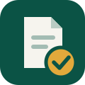
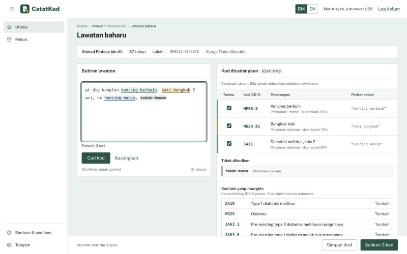

# CatatKod

**Tulis macam biasa. Kod ICD-11 siap.** Write as usual, ICD-11 codes ready.

CatatKod turns the clinic notes Malaysian nurses actually write (colloquial Malay, English or a mix, full of
shorthand) into suggested **ICD-11** diagnosis codes, each linked to the words it came from, for the nurse to
confirm. Built for CodeFest '26, Track 1: HealthTech.

```
pt dtg komplen kencing berbuih, kaki bengkak 3 ari, hx kencing manis. takde demam
  →  MF96.Z  Proteinuria
     MG29.01 Oedema of lower limbs
     5A11    Type 2 diabetes mellitus
     (not coded: fever, denied)
```

> **Prototype.** Trained and tested on synthetic notes only; not clinically validated. Every code is a suggestion
> that a nurse must confirm. Do not use with real patient data.



## Why

Malaysia is putting every public clinic on a digital record (the RM1 billion Persada initiative; the cloud clinic
system planned for 2,917 clinics by 2028), and the typing falls on nurses who already report overtime to keep
records accurate. NCD patients, the largest groups in primary care (NHMS 2023: 15.6% of adults with diabetes,
29.2% with hypertension), produce the densest, slowest notes to code.

## How it works

1. **Normalise:** expand shorthand (*pt, hx, dtg, ari, h/o, x3/7*) and mark denials and doubts
   (*takde demam, denies fever, ?denggi, r/o TB*) so they are never coded.
2. **Tier 1:** a Malay–English clinical lexicon (1,168 phrases) plus a trained classifier suggest codes from
   121 common primary-care conditions.
3. **Tier 2:** search across all ~17,000 ICD-11 diagnosis codes for anything rarer.
4. **Coding policy:** symptoms that belong to a coded diagnosis are not coded twice (tonsillitis covers sore throat).
5. **Nurse confirms** every code. The model runs locally (about 9 ms per note), and the analysis step stores no
   note text; only records the nurse saves go to the database.

## Results

F1 score: how many codes it gets right, balancing wrong suggestions and missed codes (1.0 = perfect).

| System | Our held-out test notes (105) |
|---|---|
| **CatatKod** | **0.96** |
| Keyword matching | 0.87 |
| SEA-LION v4.8 120B, given our 121-code list | 0.65 |
| SEA-LION v4.8 120B, asked for ICD-11 codes directly | 0.04 |

Our own test notes share vocabulary with the lexicon, so 0.96 is optimistic. On notes written independently by a
different AI (Gemma-SEA-LION) and never inspected during development:

| Independent notes | CatatKod | Keyword matching |
|---|---|---|
| Malay / Manglish (100) | **0.82** | 0.62 |
| English-only (60) | **0.85** | 0.64 |

Full method, every experiment (including ideas that didn't work) and all tables:
[backend/training/README.md](backend/training/README.md).

## Run it

You need Python 3 and Node.js. **On a Mac, double-click `Start CatatKod.command`**: it sets everything up the
first time, starts both servers and opens the app. Or run it manually, from this folder:

```bash
cd backend && python3 -m venv .venv && .venv/bin/pip install -r requirements.txt
.venv/bin/python training/prepare_catalogue.py && .venv/bin/python training/generate_synthetic.py
.venv/bin/python training/build_dataset.py && .venv/bin/python training/train.py --allow-draft
.venv/bin/python app.py          # API on http://localhost:5001
```

In a second terminal, from this folder:

```bash
npx -y pnpm@10.34.3 install && npx -y pnpm@10.34.3 dev   # web app on http://localhost:8443
```

Log in with any staff ID and password (prototype login), open a patient, choose **Lawatan baharu**, type a note and
click **Cari kod**. The trained model file isn't stored in git, which is why the training step comes first.

**Step-by-step guide** (setup, demo, adding codes, retraining, evaluation, troubleshooting): [MANUAL.md](MANUAL.md)

## Repository map

| Path | What |
|---|---|
| `src/` | React web app (note page: `src/app/pages/NotePage.tsx`) |
| `backend/app.py` | Flask API: `/api/analyze`, `/api/icd11/search`, `/api/data` (patients and records), `/api/health` |
| `backend/nlp/` | The NLP engine: normaliser, lexicon rules, catalogue search, coding policy, pipeline |
| `backend/training/` | Lexicon, datasets, training, evaluation and LLM benchmark scripts |
| `assets/` | Images used in this README |

## Data and licences

- ICD-11 MMS catalogue: © World Health Organization, from the ICD-11 MMS Simple Tabulation, used under
  [CC BY-ND 3.0 IGO](https://creativecommons.org/licenses/by-nd/3.0/igo/). See [icd.who.int](https://icd.who.int).
- All clinical notes in this repository are synthetic: hand-written by the team, generated from templates, or
  written by SEA-LION models (AI Singapore). None come from real patients.
